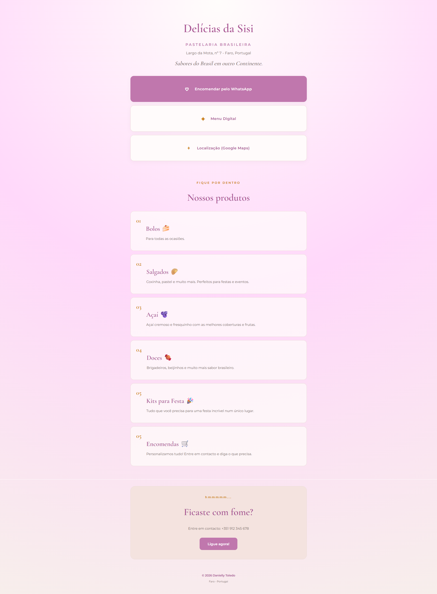

# Página para divulgação de links externos

Para fugir da dependência de plataformas privadas, onde algumas funcionalidades de personalização são pagas, foi criada uma página com o intuito de divulgar links externos.

Tecnologias: HTML4, CSS, JavaScript

## Imagem da Página

